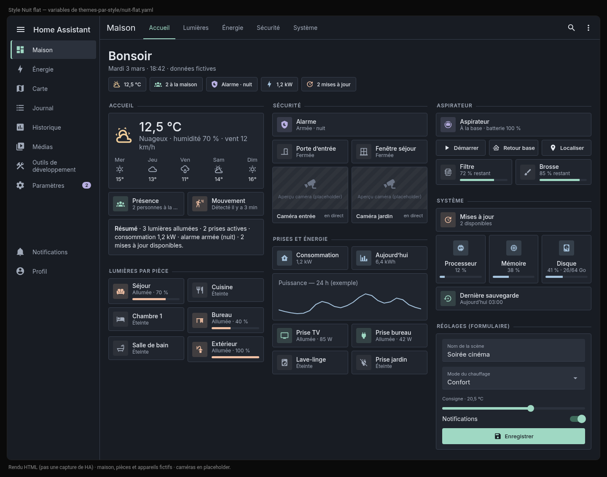
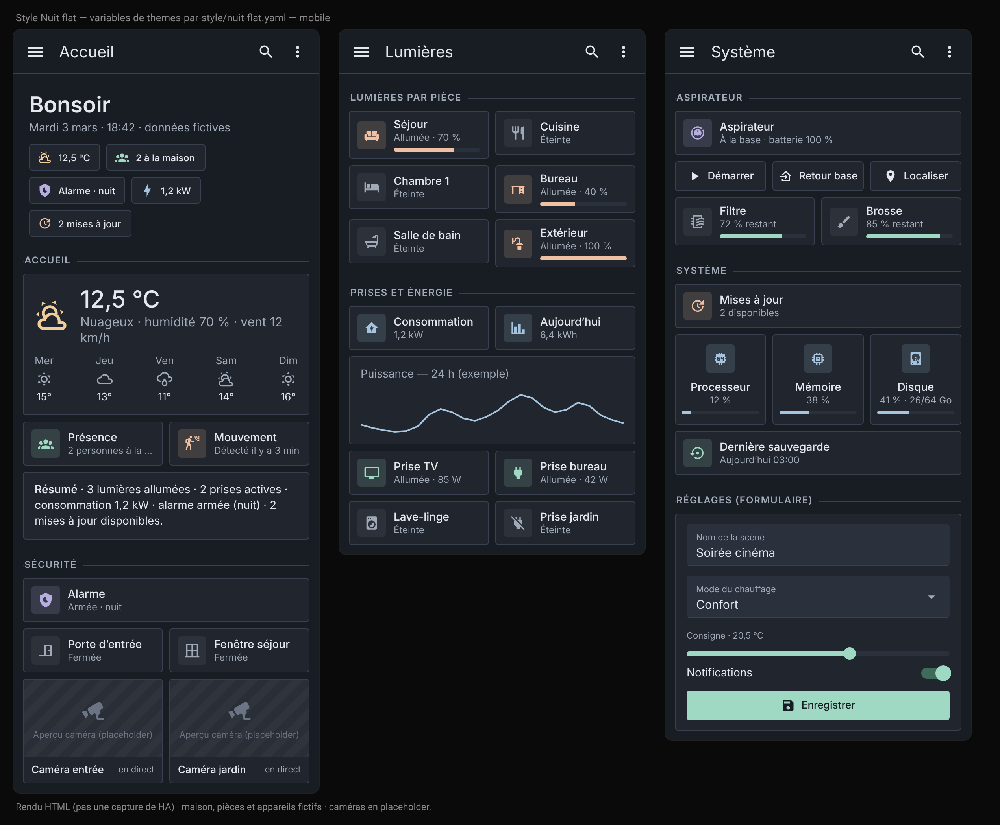
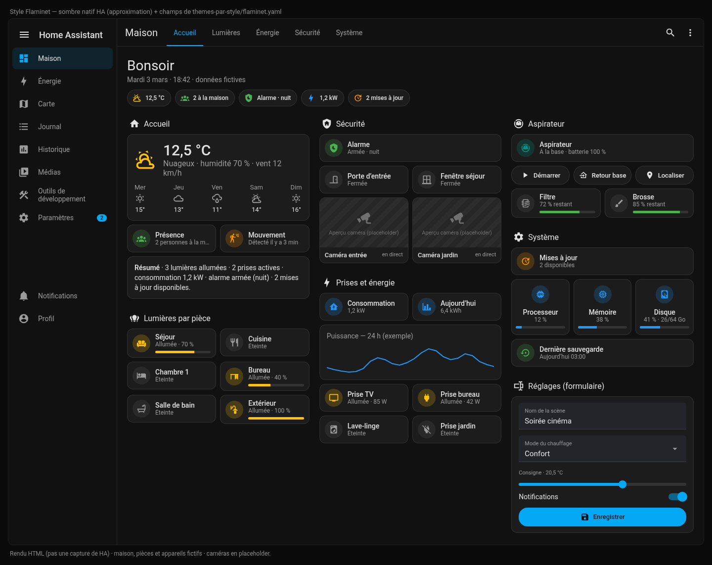
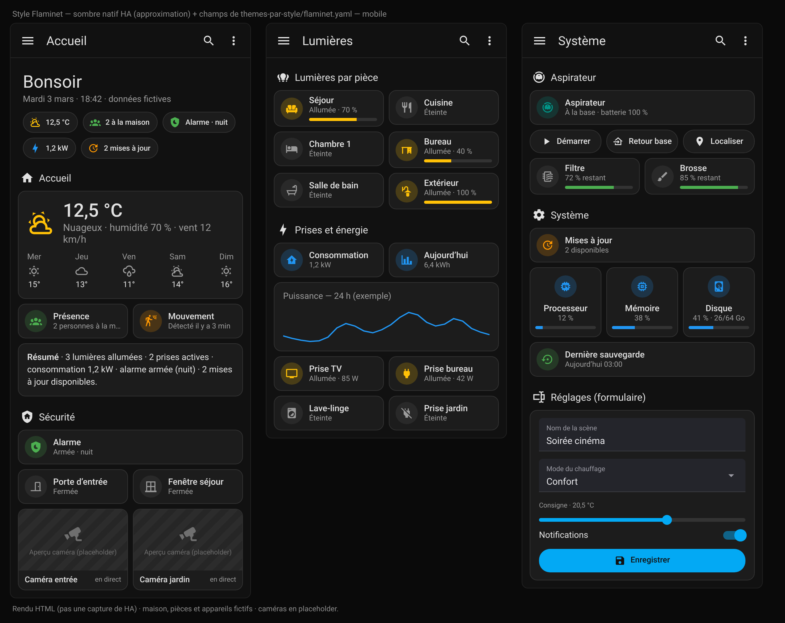
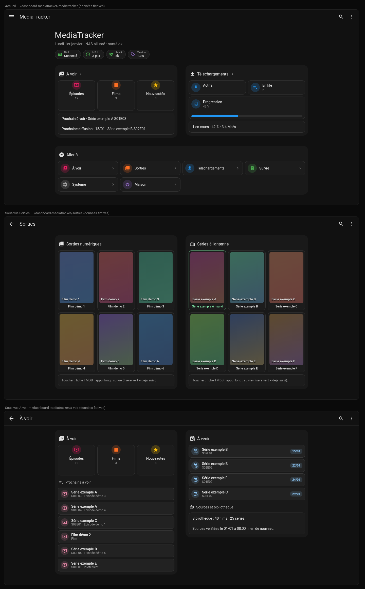
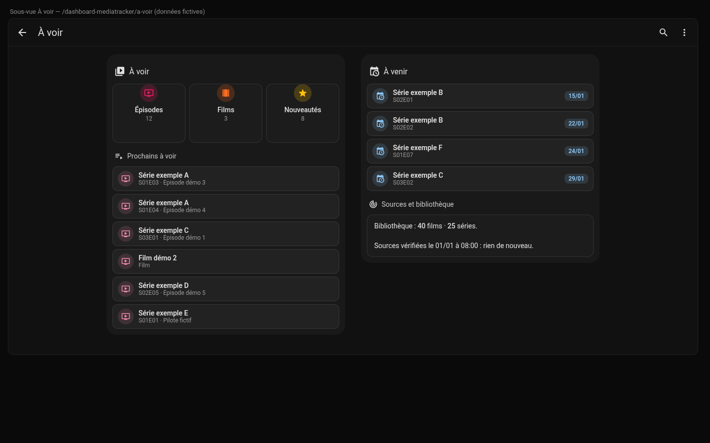

# HA Thèmes : Nuit flat & Flaminet

Thèmes, modèles button-card, extraits card-mod et dashboards d'exemple pour **Home Assistant 2026**.
Tout est en YAML lisible. Aucun secret, aucune IP : les entités des exemples sont génériques, remplace-les par les tiennes.

| Style | Contenu | État |
|---|---|---|
| **Nuit flat** | Thème `nuit_flat` complet (tout HA), police Inter, modèles `nf_*`, dashboard « Maison » | ✔ utilisé au quotidien (HA 2026.10) |
| **Flaminet** | Thème `flaminet` (HA natif sombre + champs sombres), dashboard natif, dashboard MediaTracker v7 (`mt_affiche`, `mt_attente`, `mt_liste`) | Dashboards ✔ utilisés · **thème : nouveau, non testé** |
| **Console sombre** | Dashboard MediaTracker v5 (cartes `#161618`, grille desktop), modèles `mt_bouton` et `mt_affiche` compact | ✔ utilisé (version précédente). Pas de thème dédié. |
| **Carte mt-console** | Carte JavaScript `custom:mt-console-card` aux couleurs Nuit flat | Optionnelle, **non déployée** en production |

---

## Aperçus

> Rendus HTML fidèles aux variables des thèmes (`themes-par-style/`), **pas des captures de HA**.
> Maison, pièces et appareils **fictifs**, sans nom de personne ; les caméras sont des placeholders gris.
> Écrans : accueil (météo, présence, résumé), lumières par pièce, prises et énergie, sécurité (alarme armée),
> aspirateur, système (mises à jour, CPU, mémoire, disque) et un formulaire pour montrer les champs.

### Nuit flat




### Flaminet
HA sombre natif, avec les champs de formulaire sombres du thème `flaminet` (voir l'écran « Réglages »).





---

## Contenu du dépôt

```text
themes/ha-themes.yaml          tous les thèmes en un fichier (installé par HACS) — GÉNÉRÉ
themes-par-style/              les mêmes thèmes, un fichier par style (installation manuelle)
  nuit-flat.yaml               thème nuit_flat
  flaminet.yaml                thème flaminet (nouveau, non testé)
www/nuit-flat/inter-local.js   charge la police Inter servie en local
www/mediatracker/mt-console-card.js   carte custom:mt-console-card (optionnelle)
button-card-templates/         modèles button-card (nf_*, mt_*)
dashboards/                    dashboards d'exemple (configuration brute)
snippets/                      extraits card-mod et configuration.yaml
docs/                          captures + note sur la police Inter
outils/assembler-themes.py     régénère themes/ha-themes.yaml
```

---

## Prérequis

- Home Assistant **2026.1** ou plus récent (testé en 2026.10).
- [HACS](https://hacs.xyz/).
- Cartes frontend (HACS → Tableau de bord), selon le style :

| Carte | Nuit flat | Flaminet natif | MediaTracker v7 | Console v5 |
|---|:-:|:-:|:-:|:-:|
| [card-mod](https://github.com/thomasloven/lovelace-card-mod) | ✔ (obligatoire) | — | ✔ (champs) | ✔ |
| [button-card](https://github.com/custom-cards/button-card) | ✔ | — | ✔ | ✔ |
| [Mushroom](https://github.com/piitaya/lovelace-mushroom) | ✔ | — | ✔ | ✔ |
| [layout-card](https://github.com/thomasloven/lovelace-layout-card) | ✔ | — | — | ✔ |
| [auto-entities](https://github.com/thomasloven/lovelace-auto-entities) | ✔ | — | — | — |

Le dashboard « Flaminet natif » n'utilise que des cartes natives.

---

## Installation

### 1. Activer les thèmes dans `configuration.yaml`

```yaml
frontend:
  themes: !include_dir_merge_named themes
  extra_module_url:
    - /hacsfiles/lovelace-card-mod/card-mod.js   # card-mod chargé tôt
    - /local/nuit-flat/inter-local.js            # police Inter (Nuit flat)
```

- **`extra_module_url` pour card-mod** : c'est obligatoire pour Nuit flat. Sans lui, les sections `card-mod-root`, `card-mod-sidebar`, `card-mod-more-info` et `card-mod-config` ne s'appliquent pas en dehors des dashboards (barre latérale, en-tête, fenêtres de détail).
  - Le chemin `/hacsfiles/lovelace-card-mod/card-mod.js` correspond à une installation de card-mod par HACS.
  - Ne charge card-mod **qu'une fois**. S'il figure aussi dans Paramètres → Tableaux de bord → Ressources, retire-le de là. Sinon, le journal affiche des erreurs « already defined ».
- La ligne `inter-local.js` est facultative (voir [la police Inter](docs/police-inter.md)).
- Redémarre Home Assistant.

### 2a. Via HACS (dépôt personnalisé)

1. HACS → ⋮ → **Dépôts personnalisés**.
2. URL : `https://github.com/nico2511/ha-themes`, type **Thème** → Ajouter.
3. Cherche « HA Thèmes » → Télécharger.
4. Outils de développement → Actions → `frontend.reload_themes` (ou redémarre).

HACS ne gère qu'**un** fichier de thème par dépôt. Il installe donc `themes/ha-themes.yaml`, qui contient **tous** les thèmes (`nuit_flat` et `flaminet`).
Les fichiers de `www/`, les modèles et les dashboards ne sont **pas** copiés par HACS. Copie-les à la main comme en 2b, étapes 2 à 4.

### 2b. Installation manuelle

1. Copie le ou les thèmes voulus de `themes-par-style/` dans `/config/themes/`.
   Tu peux aussi copier `themes/ha-themes.yaml` pour tout avoir.
   ⚠ N'installe pas les deux à la fois, ni en plus de la version HACS : les thèmes seraient en double.
2. Nuit flat :
   - copie `www/nuit-flat/inter-local.js` dans `/config/www/nuit-flat/` ;
   - copie les polices Inter dans `/config/www/fonts/` (voir [docs/police-inter.md](docs/police-inter.md)).
3. Carte mt-console (optionnelle) : copie `www/mediatracker/mt-console-card.js` dans `/config/www/mediatracker/`. Déclare ensuite la ressource `/local/mediatracker/mt-console-card.js` (module JavaScript).
4. `frontend.reload_themes`.

### 3. Activer un thème

- **Profil** (en bas de la barre latérale) → **Thème** : `nuit_flat` ou `flaminet`, mode **sombre**. Ce réglage vaut par utilisateur et par appareil.
- Pour l'imposer partout : action `frontend.set_theme` avec `name: nuit_flat` et `mode: dark`.
- Un dashboard peut aussi forcer son thème : clé `theme:` de la vue (le dashboard Nuit flat le fait).
- Appli Companion : vide le cache du frontend si l'ancien thème persiste.

### 4. Importer un dashboard

1. Paramètres → Tableaux de bord → **Ajouter** → « Nouveau tableau de bord vide ».
2. Ouvre-le → ✎ → ⋮ → **Éditeur de configuration brute**.
3. Colle le fichier de `dashboards/` voulu, puis enregistre.
4. Remplace les `entity_id` par les tiens.
5. Adapte les `navigation_path` et `back_path` à l'URL de **ton** dashboard. Les exemples supposent `/dashboard-maison` et `/dashboard-mediatracker`.

Les modèles button-card sont déjà inclus dans chaque dashboard. Les fichiers de `button-card-templates/` servent à les réutiliser ailleurs : colle-les sous la clé `button_card_templates:`.

---

## Les styles en détail

### Nuit flat (`nuit_flat`)

Thème sombre et plat qui s'applique à **tout HA** :

- **Palette** : fond `#181c23`, surfaces `#20252e` / `#2b313c`, filets `#394150`.
- **Accents pastel** : menthe `#9fd8c3`, lavande `#b7aee0`, pêche `#f0c0a4`, bleu `#a6c4de`, rose `#e59a9a`.
- **Formes** : police Inter, arrondis de 4 px, aucune ombre.

| Zone | Moyen |
|---|---|
| Couleurs, fonds, textes, filets | variables |
| Police Inter | `primary-font-family`, `ha-font-family-*`, `mdc-typography-*` |
| Arrondis 4 px | `ha-card-border-radius`, `ha-dialog-border-radius`, `mdc-shape-*`, `ha-border-radius-*`, `mush-*-radius` |
| En-tête plat, onglet actif menthe | `app-header-*` + `card-mod-root-yaml` |
| Barre latérale : liseré menthe sur l'élément actif | `sidebar-*` + `card-mod-sidebar-yaml` |
| Fenêtres de détail | `ha-dialog-*` + `card-mod-more-info-yaml` |
| Codes d'état pastel (alarme : désarmée menthe, armée lavande, déclenchée rose) | `state-*-color` + couleurs nommées |
| Mushroom | `mush-rgb-*` |

- **Modèles** (`button-card-templates/nuit-flat.yaml`) :
  - `nf_base` : tuile ;
  - `nf_toggle` : bascule ;
  - `nf_light` : lumière ;
  - `nf_lecture` : lecture seule, ouvre la fenêtre de détail ;
  - `nf_valeur` : grande valeur ;
  - `nf_titre` : titre de section avec filet.
- **Dashboard** : `dashboards/nuit-flat-maison.yaml`. Il repose sur une grille `custom:grid-layout` qui s'adapte au bureau et au mobile. Les tuiles d'alarme et de caméras sont en **lecture seule**.

**Limites :**
- Écrans d'administration : couleurs, police et arrondis sont repris. En revanche, les sous-pages à shadow DOM profond ne sont pas toutes atteintes.
- Panneaux d'add-ons : ce sont des iframes, ils ne sont pas stylables.
- Écran de connexion : aucun thème ne s'y applique.
- Les sélecteurs `card-mod-*` dépendent de la structure interne du frontend. Après une mise à jour majeure, un détail peut disparaître : le rendu retombe alors sur le thème « variables seules », sans casse.

### Flaminet (`flaminet`) : nouveau

Le style « Flaminet » garde **l'apparence native** de HA : thème par défaut, couleurs nommées (`green`, `purple`…), cartes `tile`, `heading` et `shortcut`, vues `sections`.

Le thème `flaminet` n'ajoute qu'une chose en mode sombre : le **correctif des champs de saisie**. Depuis le frontend 2026, certains champs (`input_text`, `select-options`) peuvent rester blancs avec un texte gris clair. Le thème leur donne un fond `#24252b`, un texte `#e6e6ea` et un libellé `#9a9aa3`. Le mode clair n'est pas modifié.

> ⚠ **Non testé en tant que thème.** Les valeurs sont celles du card-mod réellement utilisé et validé sur deux cartes du dashboard MediaTracker v7 ([snippets/champs-sombres-ha2026.yaml](snippets/champs-sombres-ha2026.yaml)). La méthode **testée** reste ce snippet card-mod, à appliquer carte par carte.

- `dashboards/flaminet-natif.yaml` : exemple réduit, uniquement avec des cartes natives (Maison, Lumières, Baie serveur, Prises, Système).
- `dashboards/mediatracker-flaminet.yaml` : dashboard MediaTracker v7 (accueil + 5 sous-vues), avec les modèles `mt_affiche`, `mt_attente` et `mt_liste`.

### Console sombre (MediaTracker v5)

Il n'y a pas de thème : le style vient entièrement de card-mod.
- Blocs `custom:mod-card` en `#161618`, avec des coins de 16 px et un liseré `rgba(255,255,255,0.06)`.
- Petits boutons plats `mt_bouton` et affiches compactes `mt_affiche` (76×132 px).
- Grille desktop 3 colonnes.

Fichiers :
- `dashboards/mediatracker-console-v5.yaml` ;
- `button-card-templates/mediatracker-console.yaml` ;
- `snippets/carte-console-sombre.yaml`.

### Carte `mt-console-card` (optionnelle)

Carte JavaScript sans dépendance, aux couleurs Nuit flat. Elle affiche :
- la file MediaTracker ;
- le statut ;
- le dernier message.

Elle n'appelle que des services HA (`callService`).
- Exemple : `dashboards/mediatracker-console-carte.yaml`.
- **Non déployée** dans une installation réelle à ce jour.

Les dashboards MediaTracker supposent les entités du package MediaTracker (`sensor.mediatracker*`, `input_text.mediatracker_*`, `script.mediatracker_*`), qui ne sont pas fournies ici.

---

## Exemple de dashboard : MediaTracker (Flaminet, données fictives)

Le dashboard `dashboards/mediatracker-flaminet.yaml` (modèles `mt_affiche`, `mt_attente`, `mt_liste`) est un exemple d'usage du style Flaminet.
Titres (« Série exemple A », « Film démo 1 »…) et affiches (dégradés) sont fictifs.

| Accueil, Sorties, À voir | Listes `mt_liste` |
|---|---|
|  |  |

---

## Snippets

| Fichier | Rôle |
|---|---|
| `snippets/champs-sombres-ha2026.yaml` | champs de saisie lisibles en mode sombre (HA 2026), ✔ testé |
| `snippets/carte-console-sombre.yaml` | cadre « console sombre » autour de plusieurs cartes |
| `snippets/titre-section-nuit-flat.yaml` | titre de section avec filet (Nuit flat) |
| `snippets/graphe-couleur-theme.yaml` | couleur de courbe alignée sur la palette |
| `snippets/configuration-frontend.yaml` | bloc `frontend:` de `configuration.yaml` |

## Contribuer / modifier un thème

Édite le fichier de `themes-par-style/`, puis régénère le fichier HACS :

```bash
python3 outils/assembler-themes.py
```

## Licence

[MIT](LICENSE). La police Inter n'est pas incluse ; elle est sous licence SIL OFL 1.1.
