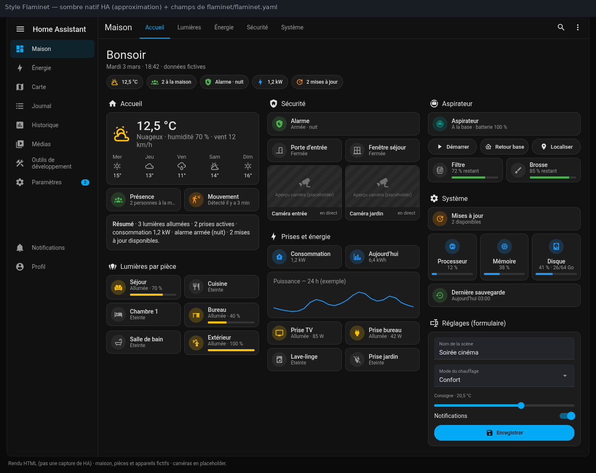

# Flaminet (`flaminet`)

Le style « Flaminet » garde **l'apparence native** de HA : thème par défaut, couleurs nommées (`green`, `purple`…), cartes `tile`, `heading` et `shortcut`, vues `sections`.
Dashboard ✔ utilisé · **thème : nouveau, non testé**.

← [Retour au sommaire](../README.md)

## Aperçu

> Rendus HTML, **pas des captures de HA**. Les champs viennent de [`flaminet.yaml`](flaminet.yaml) ; le reste est une approximation du thème sombre par défaut de HA. Maison fictive (voir l'écran « Réglages » pour les champs).




## Contenu

```text
flaminet.yaml                                   le thème (mode sombre uniquement)
dashboards/flaminet-natif.yaml                  dashboard réduit, cartes natives uniquement
captures/                                       aperçus
```

Snippet associé (commun) : [commun/snippets/champs-sombres-ha2026.yaml](../commun/snippets/champs-sombres-ha2026.yaml).

## Prérequis

- Home Assistant **2026.1** ou plus récent.
- Thème et dashboard natif : **aucune** carte custom. Le snippet de champs (alternative testée) demande [card-mod](https://github.com/thomasloven/lovelace-card-mod).

## Installation manuelle

1. Copie [`flaminet.yaml`](flaminet.yaml) dans `/config/themes/`. Si tu as installé le dépôt par HACS, saute cette étape : `themes/ha-themes.yaml` contient déjà `flaminet`.
2. `configuration.yaml` : `frontend: themes: !include_dir_merge_named themes` (voir [commun/snippets/configuration-frontend.yaml](../commun/snippets/configuration-frontend.yaml)). card-mod n'est pas nécessaire pour le thème.
3. Redémarre HA (ou `frontend.reload_themes`), puis choisis `flaminet` dans ton profil (mode sombre).
4. Dashboard : colle [`dashboards/flaminet-natif.yaml`](dashboards/flaminet-natif.yaml) dans l'éditeur de configuration brute. Remplace ensuite les entités par les tiennes et adapte `/dashboard-exemple`.

## Détail du thème

Le thème `flaminet` n'ajoute qu'une chose en mode sombre : le **correctif des champs de saisie**. Depuis le frontend 2026, certains champs (`input_text`, `select-options`) peuvent rester blancs avec un texte gris clair. Le thème leur donne un fond `#24252b`, un texte `#e6e6ea` et un libellé `#9a9aa3`. Le mode clair n'est pas modifié.

> ⚠ **Non testé en tant que thème.** Les valeurs sont celles du card-mod réellement utilisé et validé sur deux cartes de champs ([commun/snippets/champs-sombres-ha2026.yaml](../commun/snippets/champs-sombres-ha2026.yaml)). La méthode **testée** reste ce snippet card-mod, à appliquer carte par carte.

## Dashboard d'exemple

- [`dashboards/flaminet-natif.yaml`](dashboards/flaminet-natif.yaml) : exemple réduit, uniquement avec des cartes natives (Maison, Lumières, Baie serveur, Prises, Système).

