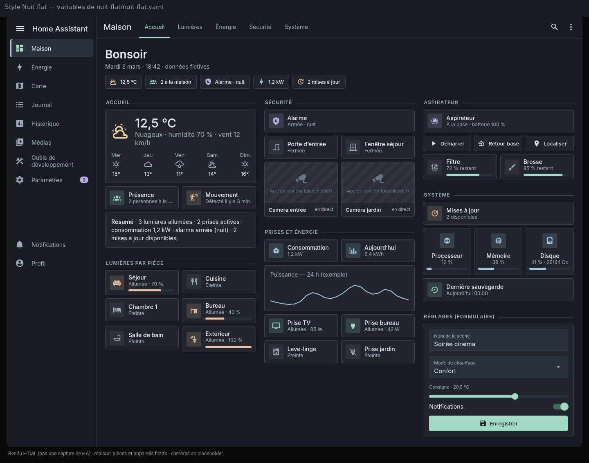
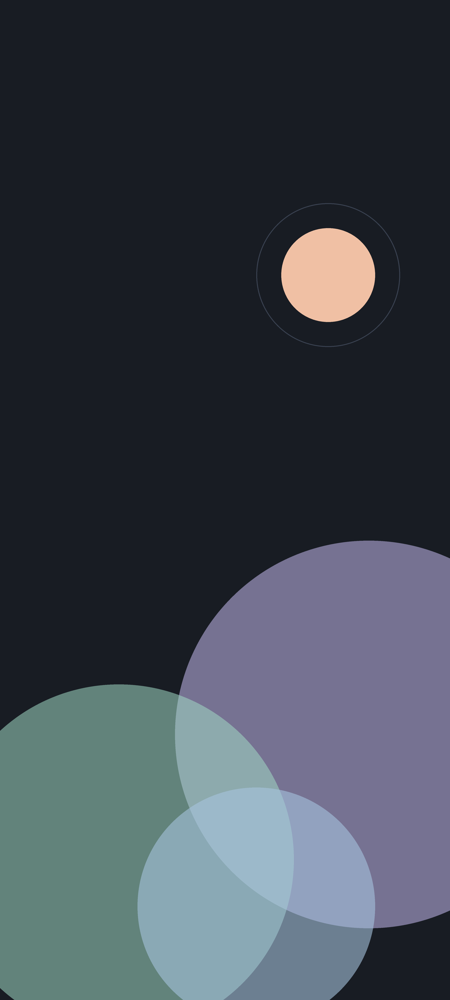
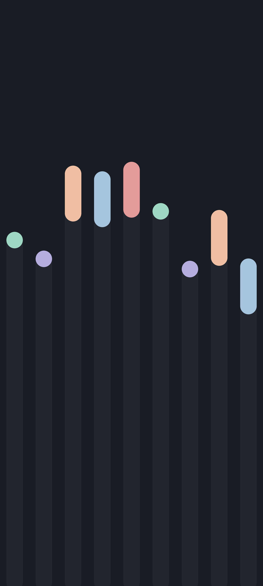
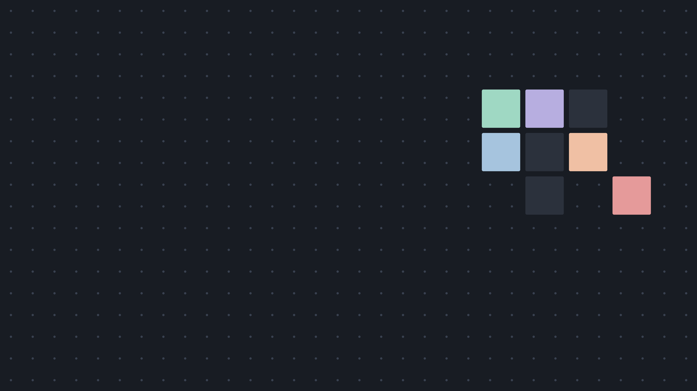

# Nuit flat (`nuit_flat`)

Thème sombre et plat qui s'applique à **tout HA** : couleurs, fonds, cartes, barre latérale, en-tête, fenêtres de détail, champs, codes d'état, police Inter et arrondis de 4 px.
✔ Utilisé au quotidien (HA 2026.10).

← [Retour au sommaire](../README.md)

## Aperçu

> Rendus HTML fidèles aux variables de [`nuit-flat.yaml`](nuit-flat.yaml), **pas des captures de HA**. Maison fictive, caméras en placeholder.




## Fonds d'écran

Quatre fonds d'écran assortis, dessinés uniquement avec la palette du thème.

| Téléphone (1440×3200) | Ordinateur (3840×2160) |
|---|---|
| [Orbes](wallpapers/nuit-flat-telephone-orbes.png) | [Collines](wallpapers/nuit-flat-bureau-collines.png) |
| [Barres](wallpapers/nuit-flat-telephone-barres.png) | [Grille](wallpapers/nuit-flat-bureau-grille.png) |

<p>




</p>

## Contenu

```text
nuit-flat.yaml                              le thème
button-card-templates/nuit-flat.yaml        modèles nf_*
dashboards/nuit-flat-maison.yaml            dashboard « Maison » (grid-layout bureau + mobile)
snippets/titre-section-nuit-flat.yaml       titre de section avec filet
snippets/graphe-couleur-theme.yaml          couleur de courbe alignée sur la palette
www/nuit-flat/inter-local.js                charge la police Inter servie en local
police-inter.md                             installer la police Inter
captures/                                   aperçus
wallpapers/                                 fonds d'écran téléphone et ordinateur
```

## Prérequis

- Home Assistant **2026.1** ou plus récent (testé en 2026.10).
- Cartes frontend (HACS → Tableau de bord) :

| Carte | Thème | Dashboard « Maison » |
|---|:-:|:-:|
| [card-mod](https://github.com/thomasloven/lovelace-card-mod) | ✔ (obligatoire, sections `card-mod-*`) | ✔ |
| [button-card](https://github.com/custom-cards/button-card) | — | ✔ |
| [Mushroom](https://github.com/piitaya/lovelace-mushroom) | — | ✔ |
| [layout-card](https://github.com/thomasloven/lovelace-layout-card) | — | ✔ |
| [auto-entities](https://github.com/thomasloven/lovelace-auto-entities) | — | ✔ |

- Police Inter (facultative) : voir [police-inter.md](police-inter.md).

## Installation manuelle

1. Copie [`nuit-flat.yaml`](nuit-flat.yaml) dans `/config/themes/`. Si tu as installé le dépôt par HACS, saute cette étape : `themes/ha-themes.yaml` contient déjà `nuit_flat`.
2. Dans `configuration.yaml` (voir [commun/snippets/configuration-frontend.yaml](../commun/snippets/configuration-frontend.yaml)) :

   ```yaml
   frontend:
     themes: !include_dir_merge_named themes
     extra_module_url:
       - /hacsfiles/lovelace-card-mod/card-mod.js   # card-mod chargé tôt
       - /local/nuit-flat/inter-local.js            # police Inter (facultatif)
   ```

   - **`extra_module_url` pour card-mod** est obligatoire : sans lui, les sections `card-mod-root`, `card-mod-sidebar`, `card-mod-more-info` et `card-mod-config` ne s'appliquent pas en dehors des dashboards.
   - Le chemin `/hacsfiles/lovelace-card-mod/card-mod.js` correspond à une installation de card-mod par HACS.
   - Ne charge card-mod **qu'une fois**. S'il figure aussi dans Paramètres → Tableaux de bord → Ressources, retire-le de là. Sinon, le journal affiche des erreurs « already defined ».
3. Police Inter : copie [`www/nuit-flat/inter-local.js`](www/nuit-flat/inter-local.js) dans `/config/www/nuit-flat/`, puis les polices dans `/config/www/fonts/` ([police-inter.md](police-inter.md)).
4. Redémarre HA, puis choisis `nuit_flat` dans ton profil (mode sombre).
5. Dashboard : colle [`dashboards/nuit-flat-maison.yaml`](dashboards/nuit-flat-maison.yaml) dans l'éditeur de configuration brute. Remplace ensuite les entités par les tiennes et adapte `/dashboard-exemple`.

## Détail du thème

- **Palette** : fond `#181c23`, surfaces `#20252e` / `#2b313c`, filets `#394150`.
- **Accents pastel** : menthe `#9fd8c3`, lavande `#b7aee0`, pêche `#f0c0a4`, bleu `#a6c4de`, rose `#e59a9a`.
- **Formes** : police Inter, arrondis de 4 px, aucune ombre.

| Zone | Moyen |
|---|---|
| Couleurs, fonds, textes, filets | variables |
| Police Inter | `primary-font-family`, `ha-font-family-*`, `mdc-typography-*` |
| Arrondis 4 px | `ha-card-border-radius`, `ha-dialog-border-radius`, `mdc-shape-*`, `ha-border-radius-*`, `mush-*-radius` |
| En-tête plat, onglet actif menthe | `app-header-*` + `card-mod-root-yaml` |
| Barre latérale : liseré menthe sur l'élément actif | `sidebar-*` + `card-mod-sidebar-yaml` |
| Fenêtres de détail | `ha-dialog-*` + `card-mod-more-info-yaml` |
| Codes d'état pastel (alarme : désarmée menthe, armée lavande, déclenchée rose) | `state-*-color` + couleurs nommées |
| Mushroom | `mush-rgb-*` |
| Champs de saisie (fond `#2b313c`, texte clair, filets `#394150`) | `input-*`, `mdc-text-field-*`, `mdc-select-*` + jetons HA 2026 `ha-color-form-*`, `ha-color-border-neutral-*`, `wa-form-control-*` |

> ⚠ **v1.1.0 : champs sombres HA 2026 ajoutés, non testés dans HA.** Les variables `ha-color-form-*`, `ha-color-border-neutral-*` et `wa-form-control-*` reprennent le modèle du snippet [commun/snippets/champs-sombres-ha2026.yaml](../commun/snippets/champs-sombres-ha2026.yaml), avec les couleurs Nuit flat. Si un champ reste clair, applique ce snippet carte par carte (testé).

**Modèles** ([`button-card-templates/nuit-flat.yaml`](button-card-templates/nuit-flat.yaml)) :
- `nf_base` : tuile ;
- `nf_toggle` : bascule ;
- `nf_light` : lumière ;
- `nf_lecture` : lecture seule, ouvre la fenêtre de détail ;
- `nf_valeur` : grande valeur ;
- `nf_titre` : titre de section avec filet.

**Dashboard « Maison »** : grille `custom:grid-layout` adaptée au bureau et au mobile. Les tuiles d'alarme et de caméras sont en **lecture seule**.

**Limites** :
- Écrans d'administration : couleurs, police et arrondis sont repris. En revanche, les sous-pages à shadow DOM profond ne sont pas toutes atteintes.
- Panneaux d'add-ons : ce sont des iframes, ils ne sont pas stylables.
- Écran de connexion : aucun thème ne s'y applique.
- Les sélecteurs `card-mod-*` dépendent de la structure interne du frontend. Après une mise à jour majeure, un détail peut disparaître : le rendu retombe alors sur le thème « variables seules », sans casse.
